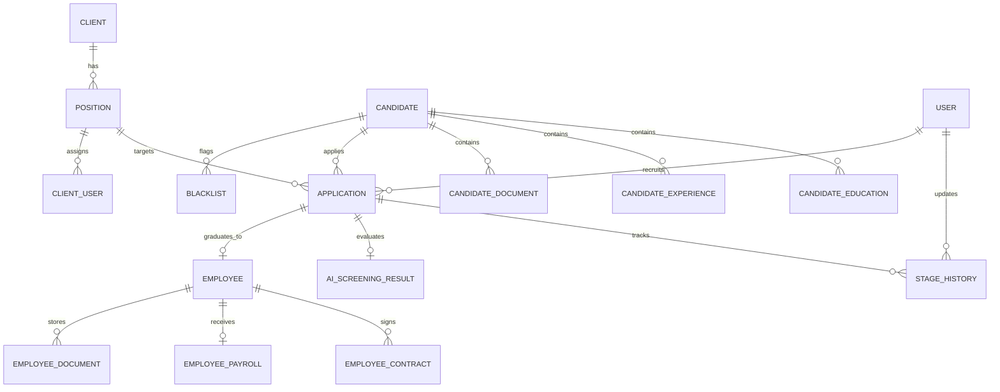
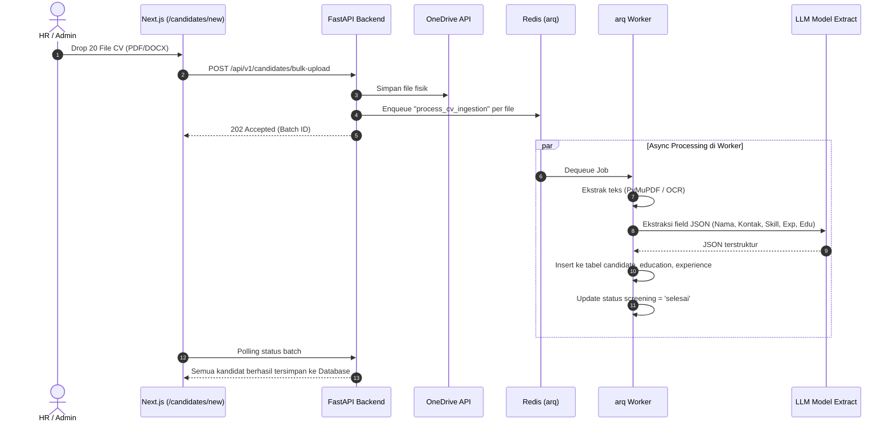

# Design — Talent Management System (TMS)
**Client:** Altek  
**Versi:** 2.0 (Pasca-UAT Flow Revision)  
**Tanggal:** Oktober 2026  

---

## 1. Arsitektur Keseluruhan

### 1.1 High-Level Architecture

```
┌──────────────────────────────────────────────────────────────────────┐
│                        Browser / Client                              │
│                    Next.js (App Router, SSR/CSR)                     │
└──────────────────────┬───────────────────────────────────────────────┘
                       │ HTTPS (REST API / JSON)
                       ▼
┌──────────────────────────────────────────────────────────────────────┐
│                     Nginx (Reverse Proxy, SSL)                       │
│              /api/* → FastAPI   |   /* → Next.js                     │
└──────┬───────────────────────────────────────┬───────────────────────┘
       │                                       │
       ▼                                       ▼
┌─────────────┐                      ┌─────────────────┐
│   FastAPI   │                      │    Next.js      │
│  (Python)   │                      │  (port 3000)    │
│  port 8000  │                      └─────────────────┘
└──────┬──────┘
       │
       ├──▶ PostgreSQL 16 (via PgBouncer)
       │       Database relasional: candidates, applications, positions, users, etc.
       │
       ├──▶ Redis 7 (arq job queue)
       │       Broker antrean job: CV ingestion, AI position scoring, cron jobs
       │
       ├──▶ arq Worker (Python runtime terisolasi)
       │       dequeue & process: PDF text extract → LLM extract → LLM position score
       │       cron: database backup, monitoring masa kontrak
       │
       ├──▶ Microsoft Graph API (OneDrive for Business)
       │       Penyimpanan dokumen CV, ijazah, sertifikat, KTP
       │
       └──▶ LLM API (OpenAI / Gemini / Anthropic)
               1. LLM Extract: ekstraksi profil terstruktur dari CV mentah
               2. LLM Match: penilaian kecocokan posisi (skor 1-100 & evaluasi)
```

### 1.2 Pembagian Peran Komponen

| Komponen | Peran & Tanggung Jawab |
|---|---|
| **Next.js** | Antarmuka pengguna (App Router), manajemen state (Zustand + React Query), validasi form (React Hook Form + Zod), proteksi rute & kondisional UI berbasis role (RBAC). |
| **FastAPI** | REST API backend, penegakan RBAC di level middleware, validasi bisnis (Blacklist, Cooldown, Duplikasi), orkestrasi arq worker, dan integrasi OneDrive Graph API. |
| **PostgreSQL** | Penyimpanan data relasional terpusat dengan integritas foreign key dan indeks teroptimasi. |
| **arq Worker** | Pemrosesan tugas latar belakang (asynchronous) untuk ekstraksi teks PDF/DOCX dan pemanggilan model LLM tanpa memblokir request HTTP frontend. |
| **Redis** | Broker antrean pesan berkecepatan tinggi untuk arq worker. |
| **OneDrive API** | Object storage dokumen fisik, menjamin VPS lokal tidak kehabisan ruang disk. |

---

## 2. Desain Database & Skema Perubahan v2.0

### 2.1 Entity Relationship Diagram (ERD Ringkas)



### 2.2 Penyesuaian Kolom Skema (Database Migration v2.0)

Untuk mengakomodasi alur pasca-UAT tanpa memecah integritas relasi, dilakukan penambahan kolom pada tabel yang sudah ada:

#### A. Tabel `candidate` (Penambahan Status Talent Pool)
```sql
-- Penambahan enum dan kolom status pool
CREATE TYPE pool_status_enum AS ENUM ('database', 'talent_pool', 'future_lead');

ALTER TABLE candidate 
    ADD COLUMN pool_status pool_status_enum DEFAULT 'database' NOT NULL,
    ADD COLUMN talent_pool_reason VARCHAR(100) NULL, -- 'gaji_tidak_sesuai', 'kebutuhan_masa_depan', 'lainnya'
    ADD COLUMN talent_pool_notes TEXT NULL,
    ADD COLUMN talent_pool_updated_at TIMESTAMP WITH TIME ZONE NULL,
    ADD COLUMN talent_pool_updated_by UUID REFERENCES "user"(id) ON DELETE SET NULL;

CREATE INDEX idx_candidate_pool_status ON candidate(pool_status);
CREATE INDEX idx_candidate_expected_salary ON candidate(expected_salary);
CREATE INDEX idx_candidate_domicile ON candidate(domicile);
```

#### B. Tabel `application` (Asosiasi User Klien)
```sql
ALTER TABLE application
    ADD COLUMN client_user_id UUID REFERENCES "user"(id) ON DELETE SET NULL,
    ADD COLUMN client_user_name VARCHAR(255) NULL; -- nama PIC User dari sisi client (e.g., 'Joni', 'Ahmad')
```

#### C. Tabel `position` (Spesifikasi Kriteria Posisi & User PIC Klien)
```sql
-- Menyimpan budget gaji maksimal, kota penempatan, dan daftar user PIC klien
ALTER TABLE position
    ADD COLUMN salary_budget NUMERIC(15, 2) NULL,        -- budget maksimal gaji posisi (contoh: 15000000.00)
    ADD COLUMN location VARCHAR(255) NULL,               -- kota penempatan (contoh: 'Jakarta', 'Bandung')
    ADD COLUMN client_user_names JSONB DEFAULT '[]'::jsonb; -- e.g. ["Joni", "Ahmad", "Siti"]

CREATE INDEX idx_position_salary_budget ON position(salary_budget);
CREATE INDEX idx_position_location ON position(location);
```

---

## 3. Desain API (FastAPI) & RBAC Enforcement

### 3.1 Struktur Endpoint Baru & Modifikasi

```
/api/v1/candidates/
  ├── POST   /bulk-upload          → Upload batch CV langsung ke database umum (tanpa posisi)
  ├── POST   /bulk-assign          → Bulk assign kandidat terpilih ke suatu lowongan aktif
  ├── PATCH  /{id}/talent-pool     → Update status pool kandidat (database ↔ talent_pool)
  └── ... (CRUD reguler)

/api/v1/positions/
  ├── POST   /{id}/recommend-candidates → Two-Stage Matching (SQL Filter + LLM Scoring)
  └── ... (CRUD reguler)

/api/v1/applications/
  ├── POST   /                     → Pembuatan lamaran individual / batch
  └── ... (Pipeline & Stage History)
```

### 3.2 Spesifikasi Kontrak API Utama

#### 1. Ingestion CV Massal ke Database (`POST /api/v1/candidates/bulk-upload`)
* **Akses:** HR, Manager, Admin.
* **Content-Type:** `multipart/form-data`.
* **Payload:** `files: list[UploadFile]`, `source_channel: str` (opsional: e.g., 'LinkedIn', 'Glints').
* **Alur:**
  1. Validasi file (PDF/DOCX, max 5 MB).
  2. Upload fisik ke OneDrive folder `candidates/raw_cv/`.
  3. Buat record `ai_screening_result` dengan status `menunggu_ekstraksi`.
  4. Enqueue job arq: `enqueue_job("process_cv_ingestion", screening_id)`.
  5. Return response langsung (non-blocking HTTP).

#### 2. Bulk Assign Kandidat ke Posisi (`POST /api/v1/candidates/bulk-assign`)
* **Akses:** HR, Manager, Admin.
* **Request Body:**
  ```json
  {
    "candidate_ids": ["uuid-1", "uuid-2"],
    "position_id": "uuid-pos-backend",
    "client_user_name": "Ahmad",
    "run_ai_screening": false
  }
  ```
* **Aturan Khusus RBAC (Toggle AI Score):**
  ```python
  @router.post("/bulk-assign")
  async def bulk_assign_candidates(
      payload: BulkAssignRequest,
      current_user: User = Depends(get_current_user),
      db: Session = Depends(get_db)
  ):
      # Role HR dilarang keras memicu background AI screening saat assign
      run_screening = payload.run_ai_screening
      if current_user.role == "hr":
          run_screening = False  # Hard override di level API

      # Validasi Blacklist & Cooldown untuk setiap candidate_id
      # Buat Application per kandidat (stage: 'Dijadwalkan_Interview')
      # Jika run_screening == True: enqueue job scoring AI per kandidat
  ```

#### 3. Two-Stage Matching Rekomendasi AI (`POST /api/v1/positions/{id}/recommend-candidates`)
* **Akses:** HR, Manager, Admin.
* **Request Body:**
  ```json
  {
    "source": "talent_pool",  // 'talent_pool' | 'database' | 'all'
    "client_user_name": "Ahmad",
    "limit": 15
  }
  ```
* **Respons:**
  ```json
  {
    "success": true,
    "data": [
      {
        "candidate_id": "uuid-1",
        "full_name": "Rahmat Surahmat",
        "ai_score": 92.5,
        "match_reason": "Keahlian Golang dan microservices sangat relevan dengan kebutuhan backend Pinhome.",
        "expected_salary": 14000000,
        "current_pool": "talent_pool",
        "is_blacklisted": false
      }
    ],
    "meta": {
      "total_scanned_in_db": 1250,
      "passed_sql_filter": 32,
      "evaluated_by_ai": 15
    }
  }
  ```

---

## 4. Alur Proses Kunci & Arsitektur Efisiensi Token

### 4.1 Alur Ingestion CV Massal ke Database (Tanpa Posisi)



### 4.2 Arsitektur Two-Stage Matching (Penyelamat Biaya Token)

```mermaid
flowchart TD
    Start([HR klik 'Cari Rekomendasi' di /applications/new]) --> InputParams[Ambil Posisi, User Client, & Sumber]
    
    subgraph Tahap 1: SQL Hard Filter di PostgreSQL (0 Token - <10ms)
        InputParams --> SQLFilter["Query PostgreSQL:
        - Saring Sumber (pool_status)
        - Saring Budget Gaji (expected_salary <= budget)
        - Exclude Kandidat Blacklist Aktif
        - Exclude Kandidat Cooldown (<6 bulan ditolak di posisi ini)"]
        SQLFilter --> PoolFiltered["Tersaring 20 - 40 Kandidat Potensial"]
    end
    
    subgraph Tahap 2: AI Scoring Terfokus (Hemat Token)
        PoolFiltered --> RankTopK["Ambil Top 10 - 15 Kandidat Paling Relevan"]
        RankTopK --> CallLLM["Kirim ringkasan profil Top 15 + Requirement Posisi ke LLM"]
        CallLLM --> LLMResult["LLM menghasilkan Skor 1-100 dan Justifikasi Singkat (~15k Token)"]
    end
    
    LLMResult --> RenderUI[Tampilkan Tabel Rekomendasi di UI]
    RenderUI --> HRCheck[HR Centang Kandidat Pilihan]
    HRCheck --> SubmitPipeline[Klik 'Masukkan ke Pipeline Lamaran']
    SubmitPipeline --> Done([Kandidat Masuk ke Tahap 'Dijadwalkan Interview'])
```

---

## 5. Desain Frontend (Next.js) & Role-Based UI

### 5.1 Penyesuaian Navigasi & Halaman

```
/candidates                     → Database umum (Tabel semua kandidat + Checkbox multi-select)
/candidates/new                 → Bulk Upload CV langsung ke Database (Dropzone tanpa posisi)
/talent-pool                    → Tampilan khusus kandidat berstatus Talent Pool (re-use tabel)
/applications                   → Pipeline lamaran aktif (Board & List)
/applications/new               → Pusat Sourcing & Rekomendasi AI (Posisi + User Klien + Sumber)
```

### 5.2 Antarmuka Halaman `/candidates` & Bulk Action

* **Kolom Aksi & Talent Pool:**
  * Di setiap baris tabel terdapat badge status/toggle cepat untuk mengubah status kandidat menjadi `Talent Pool`.
  * Saat diklik, muncul modal ringkas meminta alasan: `Gaji Tidak Sesuai`, `Kebutuhan Masa Depan`, atau `Lainnya`.
* **Aksi Massal (Floating Action Bar saat Checkbox Terpilih):**
  * Ketika 1 atau lebih baris dicentang, muncul bar aksi:
    * `[ Pindahkan ke Talent Pool ]`
    * `[ Assign ke Lowongan ]`

### 5.3 Spesifikasi Modal "Assign ke Lowongan" & RBAC Toggle

Saat tombol `[ Assign ke Lowongan ]` diklik, modal konfirmasi muncul:

```
┌────────────────────────────────────────────────────────────────────────┐
│  Assign Kandidat ke Lowongan                                           │
├────────────────────────────────────────────────────────────────────────┤
│  Kandidat Terpilih (3 orang):                                          │
│  • Rahmat Surahmat (AI Engineer)                                       │
│  • Krisna Renaldi (Data Analyst)                                       │
│  • Hermawan (Mobile Developer)                                         │
│                                                                        │
│  Pilih Posisi / Lowongan Aktif:                                        │
│  [ Backend Engineer - Pinhome                                      ▼ ] │
│                                                                        │
│  User PIC Client (Pewawancara):                                        │
│  [ Ahmad (Tech Lead)                                               ▼ ] │
│                                                                        │
│  ────────────────────────────────────────────────────────────────────  │
│  {/* CONDITIONAL RENDER: HANYA MUNCUL JIKA ROLE === 'ADMIN' | 'MANAGER' */}
│  [✓] Jalankan AI Screening (Hitung skor kecocokan CV)                  │
│      ℹ️ AI akan menganalisis kecocokan CV kandidat di latar belakang   │
│         dan memperbarui skor di pipeline lamaran.                      │
│                                                                        │
│  {/* JIKA ROLE === 'HR': Toggle di atas sama sekali tidak dirender */} │
│                                                                        │
│                         [ Batal ]  [ Submit / Masukkan ke Pipeline ]   │
└────────────────────────────────────────────────────────────────────────┘
```

#### Aturan Kondisional Komponen (Frontend React):
```tsx
const { user } = useAuthStore();
const canToggleAIScreening = user?.role === "admin" || user?.role === "manager";

// Di dalam render modal:
{canToggleAIScreening && (
  <div className="flex items-start gap-2 pt-2 border-t border-gray-200">
    <input
      type="checkbox"
      id="toggle-ai"
      checked={runAIScreening}
      onChange={(e) => setRunAIScreening(e.target.checked)}
      className="mt-1 h-4 w-4 rounded text-violet-600 focus:ring-violet-500"
    />
    <label htmlFor="toggle-ai" className="text-xs text-gray-700">
      <span className="font-semibold block text-gray-900">Jalankan AI Screening</span>
      Hitung skor kecocokan CV kandidat secara otomatis di latar belakang.
    </label>
  </div>
)}
```

### 5.4 Antarmuka Halaman `/applications/new` (Pusat Sourcing)

Halaman ini mengimplementasikan tata letak sesuai kebutuhan klien (Screenshot `application_sumber.png` & `application_user.png`):

```
┌────────────────────────────────────────────────────────────────────────┐
│  Tambah Lamaran & Rekomendasi AI                                       │
├────────────────────────────────────────────────────────────────────────┤
│  Posisi yang Dilamar *                                                 │
│  [ Backend Engineer - Pinhome                                      ▼ ] │
│                                                                        │
│  User Klien (PIC Pewawancara)                                          │
│  [ Joni (Engineering Manager)                                      ▼ ] │
│                                                                        │
│  Sumber Pencarian                                                      │
│  [ Talent Pool                                                     ▼ ] │
│  (Pilihan: 'Semua', 'Talent Pool', 'Database')                         │
│                                                                        │
│                [ 🔍 Cari & Screening Rekomendasi AI ]                  │
├────────────────────────────────────────────────────────────────────────┤
│  Hasil Rekomendasi AI (Top Kandidat Paling Cocok):                     │
│                                                                        │
│  [✓] Centang Semua                                                     │
│  ┌───┬───────────────────┬──────────┬────────────────────────────────┐ │
│  │[✓]│ Nama Kandidat     │ AI Match │ Rangkuman Kecocokan AI         │ │
│  ├───┼───────────────────┼──────────┼────────────────────────────────┤ │
│  │[✓]│ Rahmat Surahmat   │   92%    │ Mahir Go, Microservices, 4 thn │ │
│  │[✓]│ Krisna Renaldi    │   85%    │ Kuat di SQL, Data, Python      │ │
│  │[ ]│ Hermawan          │   58%    │ Mobile dev, Go masih basic     │ │
│  └───┴───────────────────┴──────────┴────────────────────────────────┘ │
│                                                                        │
│                     [ Masukkan 2 Kandidat Terpilih ke Pipeline ]       │
└────────────────────────────────────────────────────────────────────────┘
```

---

## 6. Desain Keamanan & Kontrol Biaya (Cost Control)

| Aspek | Kebijakan & Penegakan Teknis |
|---|---|
| **Pencegahan Token Leak** | Hard filter SQL wajib dieksekusi sebelum payload masuk ke LLM API. Maksimal 15 kandidat yang dikirim ke LLM per permintaan pencarian. |
| **RBAC Enforcement Ganda** | Jika role `hr` mencoba memanggil API `POST /bulk-assign` dengan payload `run_ai_screening: true` (misal via modifikasi request DevTools), FastAPI secara otomatis mematikan flag tersebut menjadi `false`. |
| **Pencegahan Duplikasi Lamaran** | Validasi `UNIQUE (candidate_id, position_id, status='active')` mencegah satu kandidat memiliki 2 lamaran aktif sekaligus pada posisi yang sama. |
| **Cooldown & Blacklist Check** | Kandidat blacklist atau dalam masa cooldown (ditolak < 6 bulan pada posisi serupa) dieliminasi dari rekomendasi AI dan memunculkan pop-up konfirmasi ganda jika di-assign manual. |

---

## 7. Rencana Kerja & Migrasi

1. **Sprint 1 — Backend DB & Ingestion:**
   - Tambah migrasi kolom `pool_status`, `talent_pool_reason`, `client_user_name`.
   - Implementasi endpoint `POST /api/v1/candidates/bulk-upload` (ekstraksi tanpa scoring posisi).
2. **Sprint 2 — Frontend Sourcing & Talent Pool:**
   - Tambah menu "Talent Pool" di sidebar.
   - Tambah Checkbox multi-select dan Modal Assign di tabel `/candidates` dengan kontrol RBAC toggle.
   - Refactor `/applications/new` menjadi form sourcing Two-Stage Matching.
3. **Sprint 3 — UAT & Validasi Token:**
   - Pengujian beban bulk upload 20 CV PDF.
   - Verifikasi isolasi toggle AI antara role HR vs Admin/Manager.
